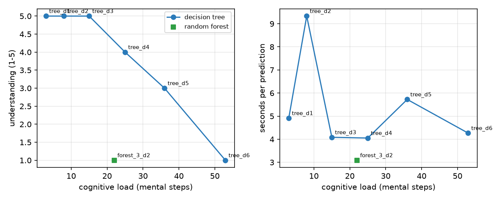
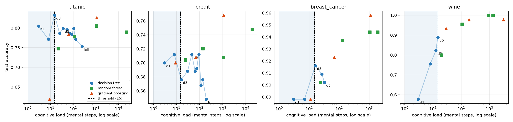

# iML 26/27 – Exercise 1: Cognitive Load of Tree Models

**How many mental steps does a person need to understand a tree model and use it by hand?**
We turn that question into a metric, _cognitive load_, that works for the whole tree model class: decision
trees, random forests and gradient-boosted trees. We apply it to 18 models on 4 datasets and use a human
self-test to find the **threshold of interpretability**.

This submission goes for **Task 1 (1 point)**.

> **Result in one sentence:** models stay interpretable up to a cognitive load of **15 mental steps** (a
> depth-3 tree). Staying below that costs **0–11 % accuracy** compared to the best model. Where a black
> box is more accurate, it needs 60–370× more mental steps.

---

## 1. The metric: cognitive load

Every tree model is made of binary decision trees. To work with one, a person has to do four kinds of work:

| Part      | What the person does                    | How we count it                                                                                                  | Kind of understanding |
| --------- | --------------------------------------- | ---------------------------------------------------------------------------------------------------------------- | --------------------- |
| **S**     | read every rule                         | number of yes/no questions (split nodes) in all trees                                                            | global                |
| **F**     | know what every feature means           | number of distinct features used anywhere in the model                                                           | global                |
| **Q**     | follow one prediction from root to leaf | questions answered per prediction, summed over all trees, weighted by the share of training samples on each path | local                 |
| **T − 1** | combine the trees' answers              | number of trees minus one (0 for a single tree)                                                                  | both                  |

$$\text{cognitive load} = S + F + Q + (T - 1) \qquad \text{(mental steps, lower = more interpretable)}$$

**Worked example:** the depth-2 tree on Titanic is "women and children first":

```
male? ── no  → class 1st/2nd? ── yes → survived
      │                      └── no  → died
      └─ yes → age ≤ 9.5?    ── yes → survived
                             └── no  → died
```

S = 3 questions, F = 3 features (sex, class, age), Q = 2 questions per passenger, T = 1 tree, so the
**cognitive load is 3 + 3 + 2 + 0 = 8**.

### Why this design

- **Global and local.** People use interpretable models in two ways: to understand the model as a whole
  (an auditor asking "how does it decide?") and to explain a single prediction (a customer asking "why
  me?"). S and F measure the first, Q the second.
- **Beyond simple size.** Q is weighted by data: a tree that answers most cases after one question is
  easier to use than an equally large tree where every case needs many questions.
- **One model class, one scale.** Forests and boosting are collections of ordinary trees. The metric adds
  up the work for every tree and charges T − 1 extra steps for combining them, so a single tree, a forest
  and a boosted ensemble are scored on the same scale.
- **Judges the actual model, not its settings.** On breast cancer and wine, trees stop growing at depth 4–5
  because the data is already separated. "max depth 10" there is exactly as easy as "max depth 5", and the
  metric shows this, while a depth limit would not.
- **One unit.** All four parts count things a person processes, so they can be added. We weight them
  equally because we have no evidence that one kind of step is harder than another (see Limitations).

The metric is implemented in [`iml_interpretability/metric.py`](iml_interpretability/metric.py), with each
part also reported as its own column. A depth-1 tree has a load of exactly 3 (tested in
[`tests/test_metric.py`](tests/test_metric.py)).

---

## 2. The threshold of interpretability: a human self-test

A threshold should come from a human, not from a formula. [`scripts/self_test.py`](scripts/self_test.py)
shows models of growing size on Titanic: decision trees of depth 1–6 and a forest of 3 trees. For each one,
the participant predicts by hand what the model says for 3 random test passengers, then rates their
understanding from 1 (not at all) to 5 (completely), or gives up.

A model **passes** if all 3 predictions are correct, the participant did not give up and the rating is at
least 3. Going from small to large, the **threshold is the load of the last model that passed** before the
first one that failed.

| Model       | Cognitive load | Correct | Rating | Result              |
| ----------- | -------------: | ------: | -----: | ------------------- |
| tree_d1     |              3 |     3/3 |      5 | pass                |
| tree_d2     |              8 |     3/3 |      5 | pass                |
| **tree_d3** |         **15** | **3/3** |  **5** | **pass (last one)** |
| forest_3_d2 |             22 | gave up |      1 | fail                |
| tree_d4     |             25 |     2/3 |      4 | fail                |
| tree_d5     |             36 |     2/3 |      3 | fail                |
| tree_d6     |             53 | gave up |      1 | fail                |

**Threshold: cognitive load ≤ 15 mental steps.**



Two observations:

- **Feeling ≠ understanding.** For tree_d4 the participant rated their understanding 4/5 but made one
  wrong prediction. Ratings alone would have set the threshold too high, which is why the test also
  checks real predictions.
- **Combining trees is harder than the metric assumes.** The 3-tree forest (load 22) was abandoned at
  once, even though a single tree with load 25 was still partly manageable. The T − 1 term probably
  underestimates the cost of reading several trees and voting.

Time per prediction turned out to be unreliable (giving up is fast too), so the threshold uses only
correctness and rating.

---

## 3. Results across models and datasets

**Datasets** ([`data.py`](iml_interpretability/data.py)):

| Dataset       | Task                        | Rows | Features (after encoding) | Classes | Source            |
| ------------- | --------------------------- | ---: | ------------------------: | ------: | ----------------- |
| titanic       | did a passenger survive?    | 1309 |                         8 |       2 | OpenML            |
| credit        | good or bad credit risk?    | 1000 |                        48 |       2 | OpenML (credit-g) |
| breast_cancer | benign or malignant tumour? |  569 |                        30 |       2 | scikit-learn      |
| wine          | which of 3 cultivars?       |  178 |                        13 |       3 | scikit-learn      |

**Models** ([`models.py`](iml_interpretability/models.py)): decision trees of depth 1–10 and unlimited;
random forests with 3 trees of depth 2, 10 of depth 3, 100 of depth 3 and 100 unlimited; gradient boosting
with 3 rounds of depth 1, 10 of depth 2 and 100 of depth 3. Every model is trained on 75 % of each dataset
and its accuracy is measured on the remaining 25 % (seed 0).



**Best interpretable model (load ≤ 15) vs. best model overall:**

| Dataset       | Best interpretable | Accuracy | Load | Best overall  | Accuracy | Load | Accuracy lost |
| ------------- | ------------------ | -------: | ---: | ------------- | -------: | ---: | ------------: |
| titanic       | tree_d3            |   83.2 % |   15 | tree_d3       |   83.2 % |   15 |     **0.0 %** |
| credit        | tree_d2            |   71.2 % |    8 | boost_100_d3  |   76.8 % | 1105 |         5.6 % |
| breast_cancer | tree_d1            |   88.8 % |    3 | boost_100_d3  |   95.8 % | 1110 |         7.0 % |
| wine          | tree_d4            |   88.9 % | 14.8 | forest_100_d3 |    100 % |  924 |        11.1 % |

### Findings

1. **On Titanic the interpretable model is also the best model.** Deeper trees get _worse_ (the unlimited
   tree reaches 75.3 %) because they memorise the training passengers (overfitting).
2. **Elsewhere, black boxes win a little at a huge cost.** 5–11 % more accuracy needs 60–370× more mental
   steps. Whether that is worth it depends on the application: a bank that must explain rejections might
   prefer the 8-step tree on credit.
3. **The threshold cuts off almost all ensembles.** Only the tiniest one, 3 boosting stumps (load 9–11 on
   the binary datasets), stays below 15, and it is never more accurate than the best single tree (61.9 % on
   Titanic). A forest of 3 small trees (load 20–25) is already beyond the threshold. The self-test suggests
   the metric is, if anything, too generous to ensembles.
4. **Wine shows the metric judges the actual tree.** tree_d4 counts as interpretable (load 14.8) because
   it stopped growing at 6 questions, while on Titanic a depth-4 tree uses 15 questions and has load 25.

Full results for all 72 (dataset, model) pairs: [`results/scores.csv`](results/scores.csv).

---

## 4. Limitations

- **Equal weights** for S, F, Q and T − 1 are a simplifying assumption. The self-test suggests combining
  trees should weigh more.
- **One participant**, 3 passengers per model and a fixed small-to-large order: the threshold is a first
  estimate, not a general human limit. Practice effects are possible.
- **One train/test split** per dataset. Accuracy on small datasets is noisy (wine has 45 test rows), so
  differences of a few percent should not be over-interpreted.
- The self-test used only Titanic; the threshold may differ for datasets with less familiar features.

---

## 5. Reproduce

```bash
uv sync --extra dev
uv run pytest                               # 10 tests
uv run python scripts/run_experiment.py     # results/scores.csv, summary.csv and the main plot
```

The self-test answers that set the threshold are committed in
[`results/self_test.csv`](results/self_test.csv), so `run_experiment.py` reproduces the results above
without repeating the test. To take the test yourself (interactive, about 15 minutes; this overwrites the
CSV):

```bash
uv run python scripts/self_test.py
```

Titanic and credit are downloaded from OpenML on the first run and cached in `data/`.

### Repository structure

```
iml_interpretability/
├── data.py        # the 4 datasets
├── models.py      # the 18 models (trees, forests, boosting)
├── metric.py      # CognitiveLoad and its parts S, F, Q, T
└── evaluate.py    # fits all models on all datasets and computes accuracy + metrics (from the template)
scripts/
├── run_experiment.py   # main experiment, summary table and plot
└── self_test.py        # human self-test for the threshold
tests/                  # tests for the metric and the pipeline
results/                # committed results and plots
presentation/           # presentation.pdf
```

---

## AI statement

We used Claude Code (Claude Opus 5.5) for this exercise. We am new to machine learning, so we first used it to -
learn the concepts: decision trees, train/test splits, accuracy, overfitting, correlation vs. causation and local vs. global interpretability.

We then under Claude codes supervision wrote the code (metric, models, datasets, experiment and self-test scripts, tests) and this README, and explained every part to us. We ran the experiments, took the human self-test, which sets the threshold, checked the results, and made the presentation slides ourselves without AI. We take responsibility for the content of this repository.
